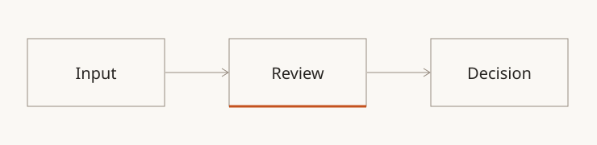

+++
title = 'A field guide to technical writing'
subtitle = 'Code, evidence, and enough context to follow the argument.'
date = 2025-12-11T08:30:00+13:00
description = 'The Ash content specimen: headings, code, tables, diagrams, footnotes, and mathematical notation.'
tags = ['systems', 'writing', 'mathematics']
categories = ['Technology']
series = ['Working notes']
+++
A technical article has to carry several kinds of information at once. It needs an argument, enough detail to inspect the mechanism, and a clear route through the evidence.

This specimen brings those elements together. It also tests Māori macrons: **tēnā koe, whānau, Aotearoa**.

<!--more-->

## Give the reader a map

Headings divide the argument into useful steps. A table of contents helps a reader move directly to a detail, then return to the main thread.

### State the scope

An article can introduce a subject without attempting to cover every adjacent topic. A clear boundary helps the reader interpret the examples.

#### A smaller heading

The typographic hierarchy continues through six heading levels. Reserve the smaller levels for genuinely subordinate material.

##### A detail

Short details remain readable at the normal body size.

###### A final qualification

Deeply nested headings work best in reference material.

## Show the mechanism

Inline code such as `calculate_total()` identifies an exact name. A fenced block can show the surrounding logic:

```python {linenos=inline,hl_lines=[3]}
def calculate_total(values):
    """Return the total of a sequence."""
    return sum(values)

print(calculate_total([2, 3, 5]))
```

Shell output needs its own space. A long command must scroll within the article rather than widen the page.

```text
$ example-tool inspect --format=json --include-context --source=sample-data --output=stdout --report-all-available-fields
{"state": "complete", "records": 120, "message": "This deliberately long line demonstrates horizontal scrolling within a code block."}
```

```
An unlabelled fence remains readable.
Its content can be copied without a language definition.
```

## Compare the evidence

The figures below are illustrative. They describe this example, not an observed system.

| Approach | Setup | Review | Notes |
|:---------|------:|:------:|:------|
| Manual | 2 h | Required | A direct comparison with explicit assumptions |
| Assisted | 4 h | Required | A person reviews the proposed result |
| Automated | 8 h | Exceptions | The example assumes a well-defined boundary |

A wide table also needs to remain usable on a small screen:

| Record identifier | Input description | Required observation | Decision threshold | Responsible person | Result |
|---|---|---|---|---|---|
| EXAMPLE-2025-0001 | A deliberately long input description | A separately recorded observation | A documented acceptance threshold | The named reviewer | Pending |

## Keep diagrams honest



The labels carry the meaning. The accent identifies one step without implying a status that the example does not establish.



## Make mathematical notation readable

An inline expression such as \(a^2 + b^2 = c^2\) can sit within a sentence. A longer expression receives its own line:

$$
\hat{\theta} = \operatorname*{arg\,min}_{\theta} \sum_{i=1}^{n} (y_i - f_\theta(x_i))^2
$$

Hugo renders these expressions to MathML during the build. The browser displays the result without a JavaScript maths library.

## Explain the exceptions


The figures and process in this article are illustrative. Replace them with evidence that supports the argument in your own article.


> A quotation needs enough context for the reader to understand its role.
>
> A second paragraph remains part of the same quotation.

Definitions provide another useful reference structure:

Assumption
: A proposition used to make progress before sufficient evidence exists.

Observation
: Something recorded about the system under discussion.

The same prose style supports checklists:

- [x] Name the question.
- [x] State the assumptions.
- [ ] Review the result.

## Cite the source

A footnote keeps supporting detail close to the claim.[^context] More than one reference can point to the same note.[^context]

For a simple Markdown link, visit the [Hugo documentation](https://gohugo.io/documentation/). Links can also target [another page](../considered-decisions/) or [a heading on this page](#show-the-mechanism).

[^context]: This is an example footnote. It demonstrates the return link and the spacing of reference text.
